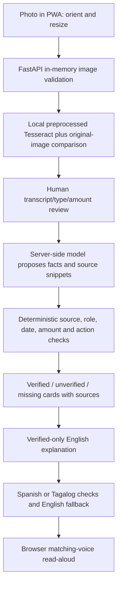

# Notice Decoder

Notice Decoder is a mobile-first PWA for understanding a photographed notice: read the text, check it against the photo, choose the document type, inspect extracted facts and their sources, then read a plain-English explanation or a guarded Spanish/Tagalog translation. It is intended for a Congressional App Challenge NJ-08 entry, including Jersey City. It is an explanatory tool, not legal advice; verify obligations with the issuing office.

**Status, 2026-10-25:** local implementation and evaluation evidence exist; deployment and phone acceptance are pending. The latest clean-checkout check passed **407 Python tests and 17 JavaScript tests** ([logs](results/m4-ablations/clean-pytest.txt), [JavaScript](results/m4-ablations/clean-node.txt)). The original held-out run had **4/30 critical false-verified fields**. That result is retained for the earlier frozen version; the final version has no independent held-out measurement. No live judge URL is available yet.

## Run locally

The clean-install audit used ARM Python 3.12.14, Tesseract 5.5.3 with English data and Node for frontend tests. Python dependencies are pinned in requirements.txt; Tesseract is a separate system dependency. Install Tesseract with your system package manager (`brew install tesseract` on macOS; `tesseract-ocr` and `tesseract-ocr-eng` on Debian/Ubuntu).

```sh
python3 -m venv .venv
source .venv/bin/activate
python -m pip install -r requirements.txt
# First setup only; preserve an existing .env:
cp -n .env.example .env
chmod 600 .env
```

Edit the ignored .env locally. Keep the real key out of chat, source code and screenshots:

```dotenv
TEXT_READER=preprocessed
TESSERACT_CMD=tesseract
OPENAI_API_KEY=YOUR_PRIVATE_SERVER_KEY
OPENAI_MODEL=gpt-5.4-mini-2026-03-17
```

The model above is the measured evaluation snapshot; use it only if available to your API project. Set TESSERACT_CMD to its absolute executable path if needed. The app uses the configured model and does not silently choose another provider/model.

```sh
python -m uvicorn backend.main:app --env-file .env --reload --host 127.0.0.1 --port 8000 --no-access-log
```

Open http://localhost:8000. Choose a photo, read it, compare/correct the transcript, explicitly select its type, and confirm the text and printed amounts. Review warnings and source highlights before relying on a card. All production classifier signal lists are currently empty, so automatic type output is unknown; manual selection is required. Installation/service-worker behavior on a phone requires HTTPS and remains unverified on a deployed host.

## Architecture



The default reader is local, but confirmed text is sent to the configured model for extraction/explanation/translation. Optional vision/hybrid readers also send images externally. Image preparation, transcript review, source matching and translation checking serve different purposes; none guarantees the original fact is correct.

## Tests and evaluation

```sh
python -m pytest -q
node --test tests/*.mjs
python -m pip check
```

Keep the test reader local. Prior clean setup/startup commands and outputs are in [the install audit](results/m4-verification/commands.md); the updated code's [clean checks](results/m4-ablations/REPORT.md) reused that venv with unchanged pinned requirements. A local test run is not proof of a deployed URL or real-phone behavior.

The live dev harness is opt-in, sends synthetic text to the model and consumes API usage:

```sh
python -m eval.run --set dev --repeats 1 --out results/my-dev-run.json
```

Use a fresh output path. For a zero-model-call ablation replay:

```sh
python -m eval.ablations --input results/m4-verification/dev.json --out results/my-ablation.json
```

The original held-out attempt is already consumed. Preserve the freeze tag and ledger; do not rerun these cases as a fresh independent held-out benchmark.

## Measured results

| Version / set | Records | Method | Critical false verified | Present accuracy | Correct verified | Abstain when present |
|---|---|---|---|---|---|---|
| dev | 40 | B1 | 2/120 | 92/92 | 92/92 | 0/92 |
| dev | 40 | B2 | 2/120 | 92/92 | 92/92 | 0/92 |
| dev | 40 | full | 0/120 | 92/92 | 72/92 | 20/92 |
| adversarial | 16 | B1 | 0/48 | 48/48 | 48/48 | 0/48 |
| adversarial | 16 | B2 | 0/48 | 48/48 | 48/48 | 0/48 |
| adversarial | 16 | full | 0/48 | 48/48 | 32/48 | 16/48 |
| heldout_original | 10 | B1 | 17/30 | 11/24 | 11/24 | 0/24 |
| heldout_original | 10 | B2 | 8/30 | 17/24 | 17/24 | 0/24 |
| heldout_original | 10 | full | 4/30 | 18/24 | 14/24 | 6/24 |

Critical false verified is wrong verified deadline/amount/action divided by all three field opportunities per record. Present accuracy ignores verification status; correct verified and abstention reveal the coverage cost. Current full dev values include 20/20 present amounts withheld pending human photo review. Dev/adversarial use scorer v3; the original held-out run used earlier code and scorer v2. These rows are not a controlled before/after comparison.

The original held-out full pipeline scored 18/24 present critical facts correctly, verified 14/24 correctly, and abstained on 6/24 present facts. All-field false verification was 5/40, including an abbreviated contact. [HELDOUT_RESULTS.md](HELDOUT_RESULTS.md) retains per-case PASS/FAIL and complete failures. Strict copied-text scoring counts some equivalent wording as wrong; the real $75.00 → $75.60 OCR error and omitted action timing clauses remain failures.

| Disabled validator group | Dev critical false verified | Adversarial critical false verified |
|---|---|---|
| full | 0/120 | 0/48 |
| without_action_completeness | 0/120 | 0/48 |
| without_amount_validation | 0/120 | 0/48 |
| without_date_validation | 2/120 | 0/48 |
| without_evidence_context | 0/120 | 0/48 |
| without_readability | 0/120 | 0/48 |
| without_source_match | 0/120 | 0/48 |
| without_text_copy | 0/120 | 0/48 |
| without_human_amount_review | 0/120 | 0/48 |

Ablations replay identical saved proposals/text/answers through seven field-validator groups plus the human amount-review gate. They use no new OCR/model calls. Date validation includes calendar/source/relative-anchor/conflicting-date subchecks as one group; these subchecks are not individually measured. Other zero-change rows do not show a validator is unnecessary. [Full tables and isolation tests](results/m4-ablations/REPORT.md) include coverage and per-field results.

## Known limits

- **Handwriting:** no measured handwriting acceptance result. Printed synthetic documents do not establish handwriting reliability.
- **Poor photos:** dev uses generated clean/degraded variants; no representative real-phone capture or mobile-browser acceptance study. Blur, glare, cropping and tiny text can still produce plausible wrong OCR.
- **Classification:** all four production signal lists in `backend/classifier/signals.py` are empty. Automatic classification returns unknown; the measured pipeline uses explicit fixture type selection. This is not automatic type-classification accuracy.
- **Amounts:** current unattended evaluation withholds unreviewed amounts. All 20 present dev amounts and all 16 present adversarial amounts remain unverified. Human confirmation can still miss an OCR error; matching the text does not authenticate the photo or obligation.
- **Translation:** Spanish and Tagalog glossary files are unreviewed. Number/glossary/back-translation checks are mechanical safeguards, not native-speaker or legal-language approval. A correct translation can repeat a wrong extracted fact.
- **Read-aloud:** browser/device voices determine language availability. Desktop checks do not establish working Spanish/Tagalog voices on a judge's phone. Physical-phone testing remains outstanding.
- **Scope:** one page per request. Extra pages are not merged. English field-role, instruction and action-completeness rules are bounded heuristics; unsupported date formats and multiple obligations can cause abstention or missed distinctions.
- **Help and deployment:** configured external help resources remain TODO in `backend/languages/help.json`; no live HTTPS deployment is verified. Host secrets, request rate limiting, origin policy, deployed quota behavior and real-device acceptance remain later milestone checks.
- **Privacy:** tested normal app paths use in-memory notice processing and no-store API responses; these tests do not prove secure RAM erasure, OS/library behavior, host-log policy or provider retention. Explicit synthetic evaluation reports intentionally persist test data outside the served frontend. Vendored HEIC diagnostics are disclosed in the privacy audit.

## Evidence and project files

- [EVIDENCE](docs/EVIDENCE.md): denominators, per-field baselines, translation outcomes and test/provenance links.
- [FAILURES](FAILURES.md): original held-out failures and current dev/adversarial discrepancies, including safe abstentions.
- [DESIGN_NOTES](DESIGN_NOTES.md): current pipeline, verification policies and tradeoffs.
- [AI_USAGE](AI_USAGE.md): generated work and contribution history; Milestone 5 disclosure review is the next step.
- Older README/design/evidence/failure snapshots are preserved in [docs/history](docs/history). Their milestone-local status statements are historical, not current acceptance claims.

Application source is under backend/ and frontend/; tests are under tests/. The server serves frontend/ only. Keep .env private and access/body logging disabled. Normal notice requests are tested for in-memory processing and no-store responses; synthetic evaluation artifacts are intentionally saved outside the public frontend. See the privacy findings in [the verification report](results/m4-verification/REPORT.md).
